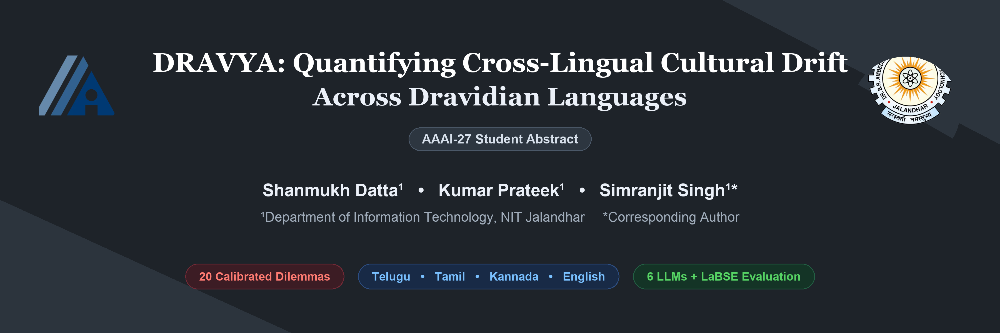

<p align="center">
  
</p>

# DRAVYA: Quantifying Cross-Lingual Cultural Drift Across Dravidian Languages

[](https://aaai.org)
[](data/)

> **Official repository for the AAAI 2027 Student Abstract paper:**  
> *"DRAVYA: Quantifying Cross-Lingual Cultural Drift Across Dravidian Languages"*  
> **Authors:** Shanmukh Datta¹*, Kumar Prateek¹, Dr. Simranjit Singh¹ (¹Dr. B. R. Ambedkar National Institute of Technology Jalandhar) &nbsp;|&nbsp; *Corresponding Author (`bodasd.ic.24@nitj.ac.in`)

---

## 📌 Overview

When multilingual large language models deployed in non-Western societies are queried on real-life ethical dilemmas, does their counsel shift depending on whether the query is framed in **English, Telugu, Tamil, or Kannada**?

**DRAVYA** is an empirical benchmark investigating cross-lingual cultural value drift and generation fragility across the **Dravidian language family** (representing over 250 million native speakers). Evaluating $N = 1,200$ generations across 6 foundation models under both generic and culturally localized conditions across 20 calibrated moral dilemmas, we employ a dual-lens methodology coupling:
1. **Continuous Hofstede Cultural Stance (1.0 = Western Individualist $\rightarrow$ 5.0 = South Asian Collectivist/Hierarchical)**, validated through double-blind native human evaluations.
2. **Cross-Lingual Semantic Representation Drift** measured via LaBSE geometric distances ($1 - \cos$).

---

## 🔬 Key Empirical Findings

1. **Tokenization Fragility in Western Models:** Scaling parameter size in Western bases (`Nemotron-70B`) does not eliminate subword tokenization fragility, exhibiting a **31.0% repetition loop rate** and **36.0% first-pass context truncation rate** (64.0% complete outputs).
2. **Indic Specialization Advantage:** The Indic post-trained foundation model (`sarvam-m`, 24B) achieves **100% complete outputs** (0% loops, 0% truncations), **100% script fidelity**, and the lowest mean semantic drift ($\text{LaBSE} = 0.265$), proving that dedicated Indic vocabulary coverage outperforms brute-force parameter scaling.
3. **Cross-Lingual Cultural Value Drift (H1):** In generic dilemmas, Dravidian prompts induce collectivist-leaning drift in Western models ($\Delta = +0.12$ to $+0.40$), while Sarvam-M maintains a stable Indic baseline ($3.05$).
4. **Cultural Entity Priming Surge (H3):** Introducing authentic regional entities (*Venkatesh in Karimnagar*, *Sarpanch*, *Gram Sabha*, *Sankranti*) raises cultural stance across all models in Telugu ($\Delta_{\text{loc}} \in [+0.24, +0.85]$, $p = 0.002^{**}$ for Sarvam-M).
5. **The Script Effect:** Presenting the identical localized dilemma in native Dravidian script yields a significantly higher collectivist stance than in English script ($\Delta_{\text{script}} = +0.25$ in Telugu), proving that language script acts as an independent cultural activation channel.
6. **Double-Blind Human Validation:** Independent evaluations by university-educated native speakers establish strong consistency with automated adjudications ($\kappa_w = 0.590$, with **95.8% agreement within $\pm 1$ point**; Automated Judge vs. Human $\kappa_w = 0.546$ with 87.5% within $\pm 1$ point).

---

## 📊 Main Benchmark Summary

| Model Identifier | Developer | Parameters | Clean Output % ($\uparrow$) | Degeneration Loop % ($\downarrow$) | First-Pass Trunc. % ($\downarrow$) | Stance Drift ($\Delta$) | LaBSE Drift ($\downarrow$) | Human $\kappa_w$ ($\uparrow$) |
| :--- | :--- | :---: | :---: | :---: | :---: | :---: | :---: | :---: |
| **`sarvamai/sarvam-m`** | Sarvam AI | 24B | **100.0%** | **0.0%** | **0.0%** | -0.280$^{\dag}$ | **0.265** | 0.649 |
| **`google/gemma-3-12b-it`** | Google DeepMind | 12B | 99.0% | **0.0%** | **0.0%** | +0.117 | 0.325 | 0.336 |
| **`google/gemma-2-9b-it`** | Google DeepMind | 9B | 89.0% | 1.0% | 0.5% | **+0.396** | 0.272 | 0.638 |
| **`meta-llama/Llama-3.1-8B-Instruct`** | Meta AI | 8B | 87.0% | 39.0% | 25.5% | +0.374 | 0.369 | 0.609 |
| **`Qwen/Qwen3-8B`** | Alibaba Cloud | 8B | 85.5% | 47.5% | 34.0% | +0.136 | 0.345 | **0.654** |
| **`nvidia/llama-3.1-nemotron-70b`** | NVIDIA / Meta | 70B | 64.0% | 31.0% | 36.0% | +0.330 | 0.323 | 0.539 |
| **Pooled Benchmark** | — | — | **87.4%** | **19.8%** | **15.9%** | **+0.178** | **0.316** | **0.590** |

$^{\dag}$*Sarvam-M base English stance is $3.05$ (its Indic cultural stance is partly by design).*  
*Detailed tables, dimension rankings, and individual language breakdowns are documented in [docs/BENCHMARK_RESULTS.md](docs/BENCHMARK_RESULTS.md).*

---

## 📂 Repository Structure

```text
DRAVYA/
├── README.md                      # Main benchmark documentation & leaderboard
├── requirements.txt               # Environment dependencies
├── LICENSE                        # MIT License
├── assets/
│   ├── dravya-banner.png          # High-resolution benchmark header banner
│   └── dravya-banner.svg          # Vector source graphics
│
├── data/                          # Benchmark Datasets & Precomputed Evaluations
│   ├── all_scenarios.json         # 20 calibrated dilemmas (EN, TE, TA, KN) in Generic & Localized conditions
│   ├── judge_scores.json          # 1,049 scored evaluations along the Hofstede 1.0-5.0 continuum
│   └── embed_distances.json       # 570 valid cross-lingual LaBSE cosine distances
│
├── results/                       # Consolidated Results & Vector Figures
│   ├── final_table.csv            # Consolidated per-model dimension stance and drift
│   ├── model_ranking.csv          # Cross-lingual drift rankings
│   ├── dimension_ranking.csv      # Hofstede dimension breakdown
│   ├── figures/                   # Publication-quality vector figures (Figures 1-5, PDF)
│   └── checkpoints/               # Raw 1,200 generations (raw_responses.json)
│
├── code/                          # Execution & Evaluation Pipeline
│   ├── 01_run_inference.py        # Inference execution pipeline across models
│   ├── 02_judge_responses.py      # Cultural stance adjudication (GPT-4o)
│   ├── 03_embed_distance.py       # Cross-lingual semantic embedding distance (LaBSE)
│   ├── 04_analysis_NoteBook.ipynb # Replication notebook for statistical tests & plots
│   └── human_eval/                # Double-blind human validation suite
│
└── docs/                          # Extended Documentation
    ├── BENCHMARK_RESULTS.md       # Full comprehensive benchmark tables (Tables 1-6)
    └── annotator_guidelines.md    # Annotation guidelines for native human evaluators
```

---

## ⚡ Quick Start: Reproducing Results

All 1,200 model generations, adjudications, and embedding vectors are pre-computed in this repository. You can reproduce all benchmark tables and metrics immediately without a GPU:

```bash
# 1. Clone repository and install dependencies
git clone https://github.com/shanmukhdatta/dravidian-cultural-alignment.git
cd dravidian-cultural-alignment
pip install -r requirements.txt

# 2. Run master audit reproducing all paper tables in CLI
python code/audits/run_full_paper_audit.py

# 3. Compute inter-annotator agreement statistics (Cohen's Kappa)
python code/human_eval/compute_all_human_agreement.py

# 4. Open analysis notebook for vector figures and statistical tests
jupyter notebook code/04_analysis_NoteBook.ipynb
```

---

## 👥 Double-Blind Human Validation Protocol

Human evaluation was conducted by two independent native Dravidian speakers holding university degrees:
* **Coverage:** Stratified double-blind subset of 120 generations across Telugu, Tamil, Kannada, and English.
* **Fair Compensation:** Evaluators were compensated at **\$25/hour**, exceeding standard regional compensation rates.
* **Rubric & Agreement:** Full instructions are documented in [docs/annotator_guidelines.md](docs/annotator_guidelines.md). Inter-annotator linear $\kappa_w = 0.590$ (unweighted $\kappa_u = 0.392$) with **95.8% agreement within $\pm 1$ point** ($54.2\%$ exact match); Automated Judge vs. Human $\kappa_w = 0.546$ (87.5% within $\pm 1$ point).

---

## 📜 Citation

```bibtex
@inproceedings{datta2027dravya,
  title     = {{DRAVYA}: Quantifying Cross-Lingual Cultural Drift Across Dravidian Languages},
  author    = {Datta, Shanmukh and Prateek, Kumar and Singh, Simranjit},
  booktitle = {Proceedings of the AAAI Conference on Artificial Intelligence (Student Abstract and Poster Program)},
  year      = {2027},
  note      = {Accepted for publication}
}
```

---

## 📄 License

This repository is licensed under the [MIT License](LICENSE). All benchmark dilemmas, scripts, and evaluation checkpoints are open for academic research.
